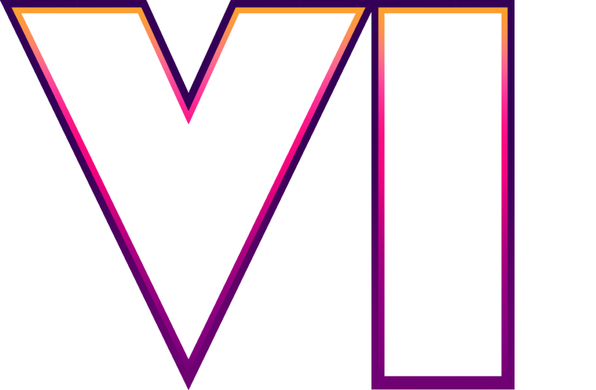
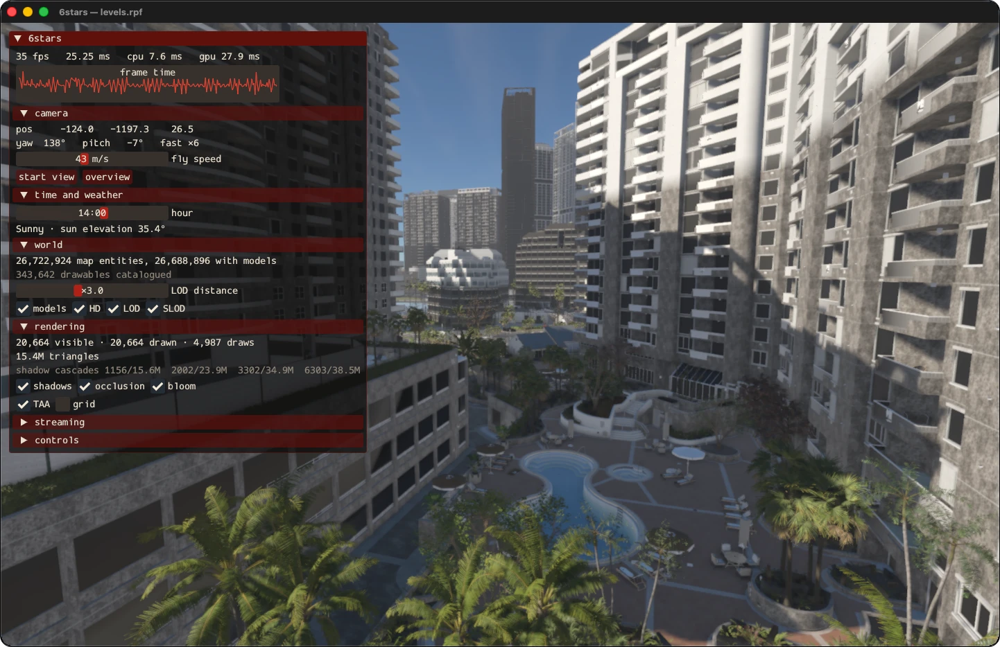
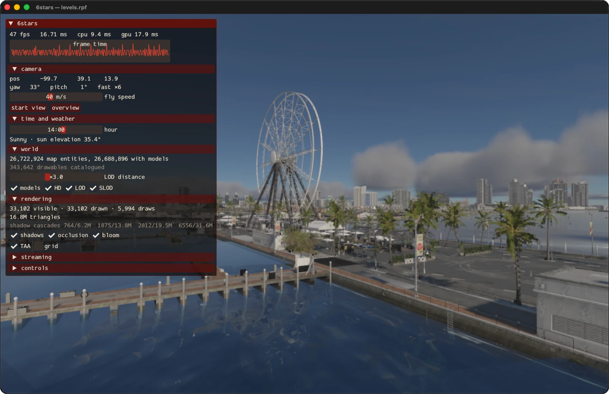
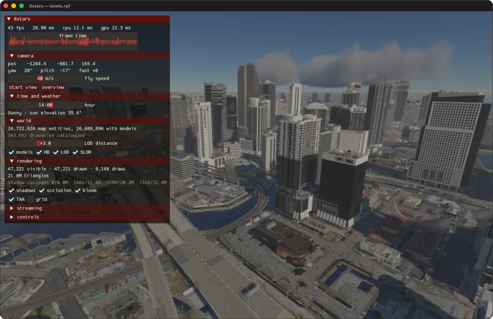
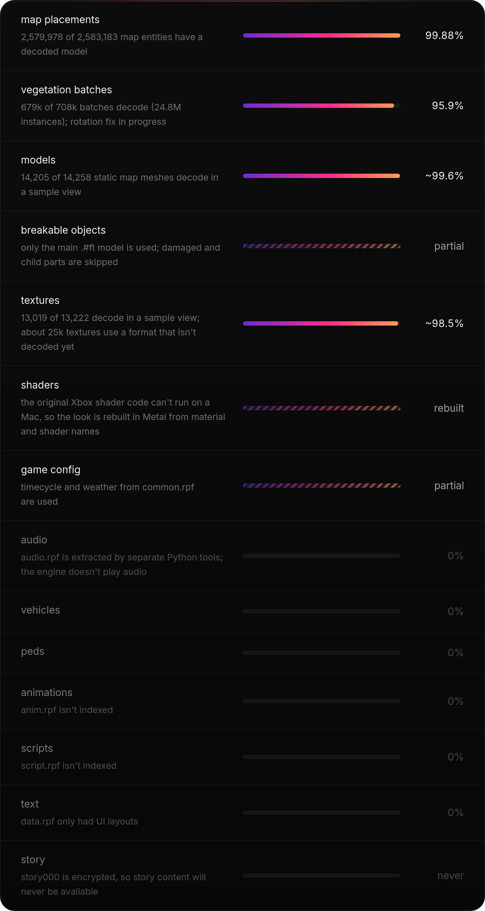

<div align="center">

<a href="https://6stars.ox80.cc"></a>

<h1>6stars</h1>

<p>Independent engine for GTA VI</p>

<p align="center">
  <a href="https://6stars.ox80.cc"><b>6stars.ox80.cc</b></a>
  &nbsp;·&nbsp;
  <a href="https://t.me/alternativekotwisia">Telegram</a>
</p>





</div>

<br>

A native macOS engine in Swift and Metal that streams the world straight out of the game's RPF9 archives: the map with its full LOD hierarchy, vegetation batches, textures, timecycle lighting and weather, a physically based sky and ocean, and the game's own minimap. Every format was worked out from the bytes.

> [!IMPORTANT]
> This repository does not contain the game, its files, keys or an executable. You need your own copy of the game data to run the engine.
>
> 6stars is written from scratch. No code, tools or assets were taken from the game or from other projects, and nothing here was derived from the game's executable, source code or original pipelines. Every format, shader and system is reimplemented from what the data files themselves show.

<p align="center"></p>

## Build

macOS 15 with the Xcode command-line tools (Swift 6, Metal).

```sh
make            # release build of 6stars and rpftool
make rpftool    # one product (engine, rpftool)
make app        # ~/testing/6stars.app, ad-hoc signed
make run ARGS="--snapshot out.png"
make clean
```

The engine reads the archives from `~/testing` (`levels.rpf`, `textures.rpf`, `common.rpf`, `data.rpf`, `data/ttdb`, `pack/`) and keeps its indices and caches in `~/testing/6stars-data`. Missing caches are rebuilt on first launch.

```sh
.build/release/6stars                                         # fly through the world
.build/release/6stars --snapshot out.png --camera x,y,z,yaw,pitch  # headless 1600×900 render
```

Click to capture the mouse, WASD to move, Shift for speed, the scroll wheel to change it, `` ` `` for the debug panel.

## Layout

| Path | What it is |
|---|---|
| `Sources/RPFKit` | RPF9 scanning and indices, resources, drawables, textures, PRD0 and PSO metadata, world data, navmeshes |
| `Sources/SixStars` | the engine: streaming, scene and LOD, deferred renderer, atmosphere, shadows, HUD, debug UI |
| `Sources/rpftool` | command-line tool for format research |
| `Sources/CImGui` | Dear ImGui through cimgui, vendored |
| `tools/` | Python research scripts |

<br>

<div align="center">
<sub>
6stars doesn't redistribute any game files. It provides documentation and an independent engine written without access to the game's executable, source code or original pipelines. 6stars is not affiliated with or endorsed by Rockstar Games or Take-Two Interactive. Grand Theft Auto and the VI logo are trademarks of Take-Two Interactive Software, Inc.
</sub>
</div>
